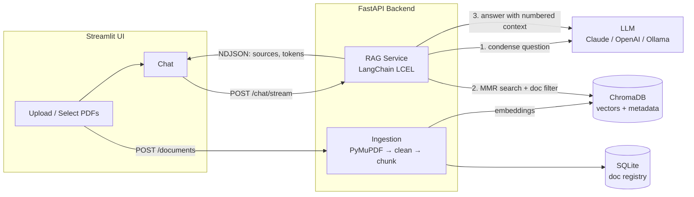

# 📄 DocuChat: Chat with Multiple PDFs using RAG

DocuChat is an end-to-end **Retrieval-Augmented Generation (RAG)** application. You upload any number of PDFs and ask questions about them in natural language. Every answer cites the source file and page number.

Built entirely in Python with **LangChain**, **ChromaDB**, **FastAPI** and **Streamlit**. The LLM provider can be switched between **Groq (free tier)**, **local models via Ollama**, **Claude (Anthropic)** and **OpenAI**. With the defaults (Groq plus local embeddings) the whole stack runs **at zero cost**.

---

## ✨ Features

- **Multi-PDF ingestion**: upload many PDFs at once. Each file is validated, parsed (PyMuPDF), cleaned, chunked and embedded.
- **Source citations**: answers cite passages inline (`[1]`, `[2]`) and show the file name, page number and snippet behind each one.
- **Conversational memory**: follow-up questions such as *"what about the second one?"* are rewritten into standalone questions before retrieval (history-aware retrieval).
- **Document scoping**: choose which PDFs to search. A metadata filter is applied in ChromaDB.
- **MMR retrieval**: Maximal Marginal Relevance gives diverse context when several PDFs overlap.
- **Streaming responses**: tokens stream from the LLM to the UI over NDJSON.
- **De-duplication**: documents are identified by SHA-256 content hash, so a file is never indexed twice. Re-ingesting is idempotent.
- **Pluggable models**: switch the LLM or embeddings with one environment variable. Local `all-MiniLM-L6-v2` embeddings on ONNX Runtime are the default, so there's no API cost and no PyTorch install.
- **Persistent storage**: ChromaDB stores the vectors and SQLite stores the document registry. Both survive restarts.
- **Evaluation script**: measures retrieval quality with Hit-Rate@k and MRR on a labelled question set.
- **Tested and containerised**: the pytest suite uses fake LLMs and embeddings, so it needs no API keys. Docker Compose runs the full stack.

## 🏗️ Architecture



**Query pipeline**
1. **Condense**: if there is chat history, the LLM rewrites the follow-up into a standalone question.
2. **Retrieve**: MMR search over ChromaDB, filtered to the selected `doc_id`s.
3. **Generate**: the LLM answers using only the numbered passages and cites them as `[n]`.
4. **Stream**: sources are sent first, then answer tokens, so the UI can show citations immediately.

## 🧰 Tech Stack

| Layer | Technology |
|---|---|
| LLM orchestration | LangChain (LCEL, prompt templates, retrievers) |
| Vector database | ChromaDB (persistent, cosine HNSW) |
| Embeddings | `all-MiniLM-L6-v2` on ONNX Runtime (default), Sentence-Transformers, OpenAI, Ollama |
| LLMs | Groq (GPT-OSS 120B), Ollama (Llama 3, Mistral, …), Anthropic Claude, OpenAI GPT |
| PDF parsing | PyMuPDF |
| Backend | FastAPI, Pydantic v2, pydantic-settings |
| Frontend | Streamlit |
| Storage | ChromaDB + SQLite |
| Testing | pytest, FastAPI TestClient, LangChain fake models |
| Deployment | Streamlit Community Cloud, Docker, Docker Compose |

## 🚀 Getting Started

### Prerequisites
- Python 3.10–3.12 (3.11 recommended)
- A free [Groq API key](https://console.groq.com/keys) (no credit card), **or** [Ollama](https://ollama.com) installed locally, **or** a paid Anthropic/OpenAI key

### 1. Install

```powershell
cd docuchat
python -m venv .venv
.venv\Scripts\activate          # macOS/Linux: source .venv/bin/activate
pip install -r requirements.txt
```

### 2. Configure

```powershell
copy .env.example .env          # macOS/Linux: cp .env.example .env
```

Edit `.env` and set `LLM_PROVIDER` and the matching key:

| Option | `.env` |
|---|---|
| **Groq (free, default)** | `LLM_PROVIDER=groq` + `GROQ_API_KEY=...` |
| Ollama (free, local) | `LLM_PROVIDER=ollama`, then run `ollama pull llama3.1` |
| Claude | `LLM_PROVIDER=anthropic` + `ANTHROPIC_API_KEY=...` |
| OpenAI | `LLM_PROVIDER=openai` + `OPENAI_API_KEY=...` |

> If Groq retires the default model, choose another from [console.groq.com/docs/models](https://console.groq.com/docs/models) and set `LLM_MODEL`.

### 3. Run

Use two terminals, both from the project root with the venv active:

```powershell
uvicorn app.main:app --reload          # API  → http://localhost:8000/docs
streamlit run ui/streamlit_app.py      # UI   → http://localhost:8501
```

The first upload downloads the embedding model (about 90 MB), so it takes a little longer.

### Run with Docker

```powershell
copy .env.example .env    # then fill it in
docker compose up --build
```

The UI is at http://localhost:8501 and the API docs at http://localhost:8000/docs. When using Ollama with Docker, set `OLLAMA_BASE_URL=http://host.docker.internal:11434`.

### Deploy for free on Streamlit Community Cloud

1. Push the repo to GitHub, then create an app at [share.streamlit.io](https://share.streamlit.io) with main file `ui/streamlit_app.py`. Under **Advanced settings**, choose Python 3.11.
2. In **Secrets**, add:
   ```toml
   GROQ_API_KEY = "gsk_..."
   EMBEDDED_API = "true"
   ```
   `EMBEDDED_API` makes the Streamlit app start the FastAPI backend in a background thread, because Community Cloud runs only one process.

Storage on Community Cloud isn't persistent, so uploaded PDFs are cleared whenever the app restarts.

## 🔌 API

Interactive docs: `http://localhost:8000/docs`

| Method | Endpoint | Description |
|---|---|---|
| `GET` | `/health` | Status and active model configuration |
| `POST` | `/documents` | Upload one or more PDFs (`multipart/form-data`, field `files`) |
| `GET` | `/documents` | List indexed documents |
| `DELETE` | `/documents/{doc_id}` | Remove a document and its vectors |
| `POST` | `/chat` | Ask a question and get the answer with sources |
| `POST` | `/chat/stream` | Same, streamed as NDJSON events (`sources`, `token`, `done`, `error`) |

Example:

```bash
curl -X POST http://localhost:8000/chat -H "Content-Type: application/json" -d '{
  "question": "What are the key findings?",
  "history": [],
  "doc_ids": null
}'
```

The API is **stateless**. The client sends the chat history with each request, so the backend scales horizontally without session storage.

## ⚙️ Configuration

All settings are environment variables (see `.env.example`):

| Variable | Default | Purpose |
|---|---|---|
| `LLM_PROVIDER` | `groq` | `groq`, `ollama`, `anthropic`, `openai` |
| `LLM_MODEL` | provider default | Override the model name |
| `EMBEDDING_PROVIDER` | `onnx` | `onnx`, `huggingface` (needs `sentence-transformers`), `openai`, `ollama` |
| `EMBEDDED_API` | `false` | `true` makes the Streamlit app start the backend itself (for single-process hosts) |
| `CHUNK_SIZE` / `CHUNK_OVERLAP` | `1000` / `150` | Text splitter settings (characters) |
| `RETRIEVAL_K` / `RETRIEVAL_FETCH_K` | `5` / `20` | Passages returned / candidates considered by MMR |
| `USE_MMR` | `true` | MMR or plain similarity search |
| `MAX_HISTORY_TURNS` | `6` | Conversation turns sent to the LLM |
| `MAX_UPLOAD_MB` | `50` | Per-file upload limit |

> Changing the embedding model changes the vector dimensions, so delete the `data/` folder and re-upload your PDFs.

## 🧪 Testing

```powershell
pytest -v
```

The tests use `DeterministicFakeEmbedding` and `FakeListChatModel`, so they run offline in seconds with no API keys. They cover parsing and validation, chunk metadata, de-duplication, document-filtered retrieval, question condensing, streaming event order and every API endpoint.

## 📊 Evaluating Retrieval

Create a labelled set of questions about your own PDFs (see `eval/questions.example.json`), index the PDFs, then run:

```powershell
python -m scripts.evaluate eval/questions.json
python -m scripts.evaluate eval/questions.json --no-mmr --k 3   # compare configurations
```

The script reports **Hit-Rate@k** and **MRR**, which you can use to tune chunk size, `k` and MMR.

## 📁 Project Structure

```
docuchat/
├── app/
│   ├── main.py           # FastAPI routes
│   ├── config.py         # Settings (pydantic-settings)
│   ├── providers.py      # LLM + embedding factories
│   ├── ingestion.py      # PDF parsing, cleaning, chunking
│   ├── documents.py      # Vector store + document lifecycle
│   ├── registry.py       # SQLite document registry
│   ├── rag.py            # Conversational RAG chain
│   ├── dependencies.py   # Dependency injection
│   └── schemas.py        # Pydantic request/response models
├── ui/streamlit_app.py   # Chat UI
├── scripts/evaluate.py   # Retrieval evaluation (Hit-Rate, MRR)
├── tests/                # pytest suite
├── Dockerfile
├── docker-compose.yml
└── requirements.txt
```

## 🧠 Design Decisions

- **Chunks never cross a page boundary.** Each page is split on its own, so every citation points to exactly one page.
- **Content-hash IDs.** `doc_id = sha256(file)[:16]` and chunk IDs are `"{doc_id}-{n}"`. Uploading the same file twice is detected, and a failed ingest can be retried without leaving duplicate vectors.
- **Question condensing before retrieval.** Embedding a follow-up like *"why?"* directly retrieves nothing useful, so it is rewritten into a standalone question first.
- **Separate API and UI.** The UI talks to the backend only over HTTP, so another frontend or a Slack bot could use the same API.
- **Sources streamed before tokens.** The UI can show where the answer comes from while it is still being generated.

